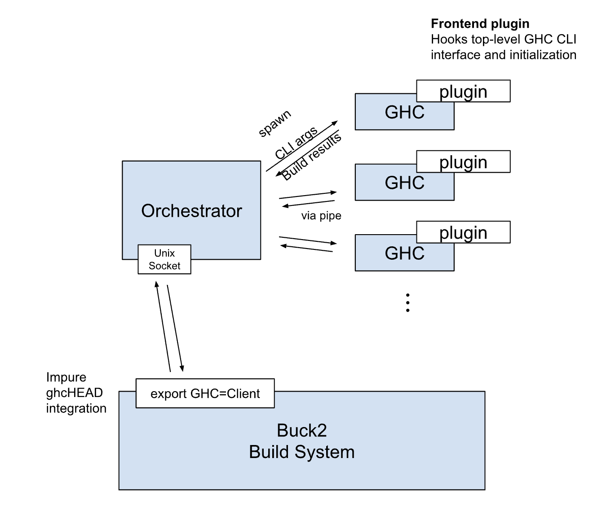

ghc-persistent-worker
=====================

Persistent worker (compiler server) implementation.
GHC persistent worker currently works with Buck2.



Build and test with

```
nix build .#ghc-worker
```

To reduce build times, you can download binaries from cachix. See the Cachix
section below.

If you need to use a locally built GHC, you can use

```
nix develop --command cabal test --with-compiler=path/to/your/ghc all
```

HLS
===

When the GHC used to build HLS includes patches that influence CPP pragmas in the worker, you need to enable those in
`cabal.project`.

An HLS version patched for the MWB GHC can be run with `nix run .#hls -- --lsp`.

Cachix
======

In order to avoid having to rebuild GHC when first using a new upstream change, you can add this Cachix instance to your
Nix config:

```nix
  nix = {
    settings.substituters = ["https://ghc-server.cachix.org"];
    settings.trusted-public-keys = ["ghc-server.cachix.org-1:VPQv6cKWK7QjnkgE/v2zMBAvqdSdyRsLt2xGh7APKWc="];
  };
```

It can be provided as CLI arguments as well:

```
$ nix --option extra-substituters https://ghc-server.cachix.org --option extra-trusted-public-keys ghc-server.cachix.org-1:VPQv6cKWK7QjnkgE/v2zMBAvqdSdyRsLt2xGh7APKWc= run .#buck-tests
```

## Implementation notes

Buck2 runs the worker as two kinds of processes.

* **buck-proxy** is what Buck2 starts as its persistent worker. It receives Buck2's
  requests over gRPC and forwards each to a **ghc-worker**, starting one for each
  `--worker-target-id` it sees.
* **ghc-worker** runs GHC's metadata and compile steps for the requests it receives,
  in one GHC session that it keeps for the whole build.

### What a worker shares

buck2-haskell derives `--worker-target-id` from the link style alone (plus `-prof` when
profiling), so one ghc-worker serves every compile of a build with that link style,
across all targets. Within a ghc-worker, every request runs with:

* the home units of every target the worker has seen, with their module graph
* one interpreter, and so one loader state, shared by all compiles

### Extra libraries

Units enter the worker's session without their `-l` options. The worker records these
libraries separately per unit. Before compilation loads a plugin, and before it evaluates
a splice or an annotation, the worker loads the recorded libraries of the
compiling unit and its home-unit dependencies. Each library is loaded only once per worker.
See `Internal.State.ExtraLibs`.

This is unlike GHC, which loads the `-l` libraries of every known home unit when its loader
starts.

Cabal Flags
===========

The project has a few optional features that depend on recent or experimental patches in GHC.
These can be toggled by specifying corresponding Cabal flags, which enable CPP defines during the build.
For example, running `cabal build -funit-index` enables the unit-index feature.

* Unit index `-funit-index`/`-DUNIT_INDEX`

  In projects with a large number of units, the performance of unit state initialization degrades substantially, because
  GHC wasn't designed for this use case.
  In particular, the package DB files of each unit's dependencies are read from disk unconditionally, even though they
  are often identical across units.
  Furthermore, the lookup table that associates module names with the packages that contain them is duplicated with
  heavy redundancies.
  In this GHC patch, these operations are abstracted away, allowing us to provide an efficient implementation locally
  that shares all of this data.

* Downsweep cache `-fdownsweep-cache`/`-DDOWNSWEEP_CACHE`

  This is a simple optimization that allows reusing old module graphs when recomputing a new graph, which we use to
  provide dependency graphs from our state.

* Abstract `Linkables` `-flinkables`/`-DLINKABLES`

  This allows the worker to hook into the bytecode loading procedure to lazily compile interface Core to bytecode when
  the module is requested for a splice or test execution.
